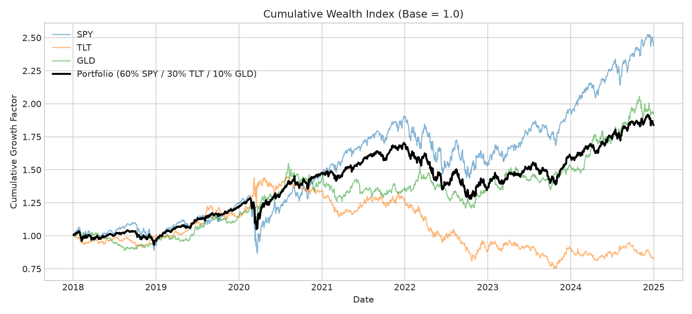
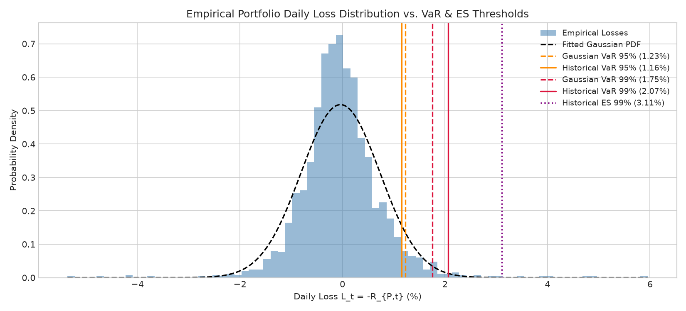
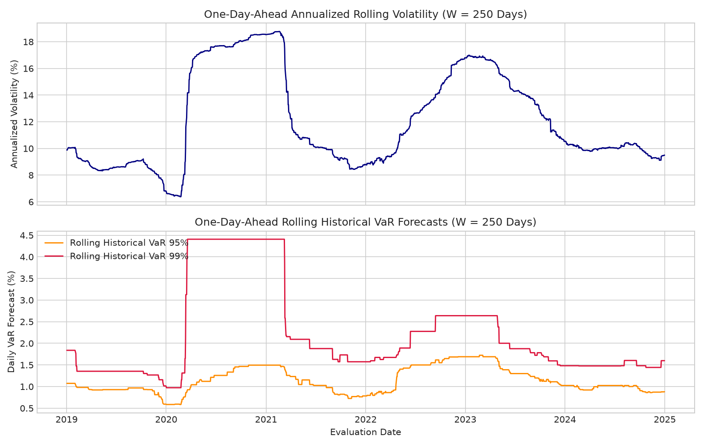
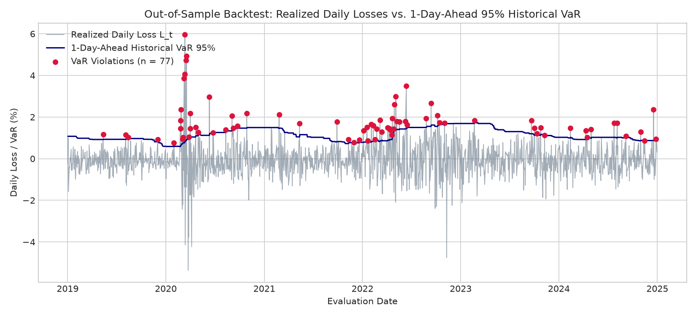
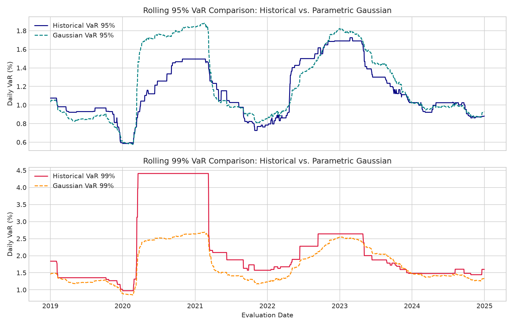

# Quantitative Market Risk Analysis Framework

A mathematically rigorous, reproducible Python framework for estimating, comparing, and backtesting portfolio market risk using **Value-at-Risk (VaR)** and **Expected Shortfall (ES)** under non-parametric (Historical) and parametric (Gaussian) methodologies.

---

## 1. Repository Structure

```text
quantitative-market-risk-analysis/
├── data.py                   # Yahoo Finance ingestion, forward-fill cleaning, and integrity validation
├── portfolio.py              # Simple vs. logarithmic returns and cross-sectional portfolio aggregation
├── risk_measures.py        # Historical & Gaussian VaR and Expected Shortfall (positive-loss convention)
├── backtesting.py            # Zero-look-ahead rolling volatility, 1-day-ahead VaR backtest, and Kupiec POF test
├── experiments.py            # End-to-end empirical study, distributional diagnostics, and figure generation
├── tests/
│   ├── __init__.py
│   ├── test_data.py          # Cleaning & validation unit tests (no look-ahead leakage)
│   ├── test_portfolio.py     # Return & weight constraint unit tests
│   ├── test_risk_measures.py # Asymptotic Gaussian checks, monotonicity, and VaR sub-additivity counterexample
│   └── test_backtesting.py   # Causal slicing verification, shock-perturbation tests, and Kupiec test validation
├── figures/                  # Generated diagnostic plots
├── requirements.txt
└── README.md
```

---

## 2. Data Provenance & Modeling Assumptions

* **Data Source:** Daily Adjusted Closing prices (`Adj Close`, `auto_adjust=False`) retrieved from **Yahoo Finance** via `yfinance`, accounting for dividends and stock splits.
* **Investment Universe & Weights:** Multi-asset portfolio composed of **60% SPY** (US Equities), **30% TLT** (20+ Year US Treasury Bonds), and **10% GLD** (Gold), evaluated from `2018-01-03` to `2024-12-31` ($T = 1,760$ daily return observations).
* **Rebalancing Assumption:** Daily constant-mix rebalancing (fixed target weights $w$), excluding transaction costs and slippage.
* **Holding Period:** 1 trading day ($h = 1$).
* **Missing Data Policy:** Geographical or calendar holiday gaps are handled strictly via causal forward-filling (`ffill()`), dropping initial incomplete rows (`dropna()`). Backward-filling (`bfill()`) is explicitly prohibited to prevent look-ahead bias.
* **Estimation Windows:** Default rolling window of $W = 250$ trading days (~1 year), with sensitivity benchmarks at $W \in \lbrace 125, 250, 500 \rbrace$ days.
* **Confidence Levels:** 95% and 99% ($1 - \alpha \in \lbrace 0.95, 0.99 \rbrace$), corresponding to tail exceedance probabilities of 5% and 1% ($\alpha \in \lbrace 0.05, 0.01 \rbrace$).

---

## 3. Mathematical Definitions & Sign Conventions

### 3.1 Simple vs. Logarithmic Returns and Portfolio Aggregation

For asset $i$ with adjusted price $P_{i,t}$ at date $t$, the **simple (arithmetic) return** and **logarithmic return** are defined respectively as:

$$R_{i,t} = \frac{P_{i,t} - P_{i,t-1}}{P_{i,t-1}}, \qquad r_{i,t} = \ln\left(\frac{P_{i,t}}{P_{i,t-1}}\right) = \ln(1 + R_{i,t})$$

Arithmetic returns aggregate linearly across portfolio assets, whereas logarithmic returns are non-linear across assets due to $\ln(A + B) \neq \ln(A) + \ln(B)$ but additive across time:

$$R_{P,t} = \sum_{i=1}^{N} w_i R_{i,t} = w^\top R_t, \qquad r_{P,t} \neq \sum_{i=1}^{N} w_i r_{i,t}, \qquad r_{0 \to T} = \sum_{t=1}^{T} r_t$$

Portfolio returns are therefore aggregated cross-sectionally using simple returns.

### 3.2 Loss Convention

Throughout this project, **losses are defined as positive numbers**:

$$L_t = -R_{P,t}$$

Consequently, adverse financial outcomes lie in the **right tail** of the loss distribution $L_t$.

### 3.3 Value-at-Risk (VaR) and Expected Shortfall (ES)

For a confidence level $1 - \alpha \in (0, 1)$:

* **Historical VaR and Expected Shortfall (non-parametric):** Empirical $(1-\alpha)$-quantile of historical losses and conditional expected loss beyond that threshold:

$$\widehat{\text{VaR}}_{1-\alpha}^{\text{hist}}(L) = \hat{q}_{1-\alpha}(L), \qquad \widehat{\text{ES}}_{1-\alpha}^{\text{hist}}(L) = \mathbb{E}\left[L \,\middle\vert{}\, L \ge \widehat{\text{VaR}}_{1-\alpha}^{\text{hist}}(L)\right]$$

* **Gaussian Parametric VaR and Expected Shortfall:** Assuming normally distributed losses with mean and standard deviation parameters derived from portfolio returns:

$$\mu_L = -\mu_R, \qquad \sigma_L = \sigma_R, \qquad z_{1-\alpha} = \Phi^{-1}(1-\alpha)$$

$$\text{VaR}_{1-\alpha}^{\text{Gauss}}(L) = \mu_L + z_{1-\alpha}\sigma_L, \qquad \text{ES}_{1-\alpha}^{\text{Gauss}}(L) = \mu_L + \sigma_L \frac{\phi(z_{1-\alpha})}{\alpha}$$

where $\phi$ and $\Phi$ denote the standard normal probability density function and cumulative distribution function, respectively.

### 3.4 Coherence and Sub-Additivity

Unlike Expected Shortfall—which satisfies all four Artzner et al. (1999) coherence axioms (monotonicity, translation invariance, positive homogeneity, and sub-additivity)—**VaR is not sub-additive in general**. For skewed or discrete loss distributions, portfolio diversification can appear to increase VaR:

$$\text{VaR}_{1-\alpha}(L_1 + L_2) > \text{VaR}_{1-\alpha}(L_1) + \text{VaR}_{1-\alpha}(L_2)$$

This violation is explicitly verified on a synthetic two-bond default distribution in `tests/test_risk_measures.py`.

### 3.5 Out-of-Sample Backtesting & Kupiec POF Test

At each evaluation date $t \in \lbrace W, \dots, T-1 \rbrace$, risk forecasts are estimated exclusively using the causal window of strictly prior losses, and a violation indicator is recorded when realized loss exceeds the forecast:

$$\mathcal{F}_{t-1}^{(W)} = \lbrace L_{t-W}, \dots, L_{t-1} \rbrace, \qquad I_t = \mathbf{1}_{\lbrace L_t > \widehat{\text{VaR}}_{t \mid t-1} \rbrace} \in \lbrace 0, 1 \rbrace$$

Over $N$ out-of-sample days, let the observed violation count and empirical violation rate be:

$$N = T - W, \qquad N_1 = \sum_{t=W}^{T-1} I_t, \qquad \hat{p} = \frac{N_1}{N}$$

Under the null hypothesis of independent Bernoulli violations at rate $\alpha$, Kupiec's (1995) Proportion of Failures (POF) likelihood-ratio statistic converges asymptotically to a chi-squared distribution with one degree of freedom:

$$H_0: I_t \stackrel{\text{i.i.d.}}{\sim} \text{Bernoulli}(\alpha) \implies LR_{\text{POF}} = -2 \ln \left( \frac{(1 - \alpha)^{N - N_1}\alpha^{N_1}}{(1 - \hat{p})^{N - N_1}\hat{p}^{N_1}} \right) \xrightarrow[N \to \infty]{d} \chi^2(1)$$

---

## 4. Installation & Reproduction

```bash
# 1. Install dependencies
pip install -r requirements.txt

# 2. Run the full unit and statistical validation suite
pytest -v

# 3. Run the empirical analysis and regenerate all figures in ./figures/
python experiments.py
```

---

## 5. Empirical Results (`2018-01-03` to `2024-12-31`)

### 5.1 Distributional Diagnostics of Portfolio Losses

* **Annualized Portfolio Return / Volatility:** 9.46% / 12.23% (Daily loss mean: -0.0375%, daily volatility: 0.7704%).
* **Max Difference Between Simple and Log Returns:** 0.001846 (18.5 bps during the March 2020 market shock).
* **Skewness of Losses:** +0.4180 (positive right-tail asymmetry in losses, equivalent to negative skewness in returns).
* **Excess Kurtosis:** +8.0771 (strongly leptokurtic vs. Gaussian benchmark 0.0).
* **Normality Tests:** Jarque-Bera = 4835.42 ($p < 10^{-16}$); Shapiro-Wilk $W = 0.9217$ ($p = 2.62 \times 10^{-29}$). Normality is decisively rejected.

### 5.2 Full-Sample Risk Estimates (Daily Relative Loss %)

| Confidence Level | Historical VaR | Gaussian VaR | Historical ES | Gaussian ES |
| :--- | :---: | :---: | :---: | :---: |
| **95%** | 1.156% | 1.230% | 1.823% | 1.552% |
| **99%** | 2.066% | 1.755% | 3.112% | 2.016% |

### 5.3 Out-of-Sample 1-Day-Ahead Backtest ($W = 250$, $N = 1,510$ OOS Days)

| Confidence | Method | Observed Violations | Expected Violations | Observed Rate | Expected Rate | $LR_{\text{POF}}$ | $p$-value | Reject $H_0$ (5%) |
| :--- | :--- | :---: | :---: | :---: | :---: | :---: | :---: | :---: |
| **95%** | Historical | 77 | 75.50 | 5.10% | 5.00% | 0.0312 | 0.8599 | False |
| **95%** | Gaussian | 66 | 75.50 | 4.37% | 5.00% | 1.3117 | 0.2521 | False |
| **99%** | Historical | 20 | 15.10 | 1.32% | 1.00% | 1.4576 | 0.2273 | False |
| **99%** | Gaussian | 32 | 15.10 | 2.12% | 1.00% | 14.4584 | 0.0001 | **True** |

### 5.4 Estimation Window Sensitivity (99% VaR Backtest)

| Window ($W$) | Method | OOS Days | Observed Violations | Expected Violations | Observed Rate | $p$-value | Reject $H_0$ (5%) |
| :--- | :--- | :---: | :---: | :---: | :---: | :---: | :---: |
| **125** | Historical | 1,635 | 32 | 16.35 | 1.96% | 0.0006 | **True** |
| **125** | Gaussian | 1,635 | 38 | 16.35 | 2.32% | 0.0000 | **True** |
| **250** | Historical | 1,510 | 20 | 15.10 | 1.32% | 0.2273 | False |
| **250** | Gaussian | 1,510 | 32 | 15.10 | 2.12% | 0.0001 | **True** |
| **500** | Historical | 1,260 | 15 | 12.60 | 1.19% | 0.5094 | False |
| **500** | Gaussian | 1,260 | 25 | 12.60 | 1.98% | 0.0020 | **True** |

---

## 6. Diagnostic Figures

### Portfolio Cumulative Wealth Index


### Empirical Loss Distribution vs. VaR & ES Thresholds


### One-Day-Ahead Rolling Volatility & Rolling VaR


### Out-of-Sample Backtest: Realized Losses vs. 95% Historical VaR


### Dynamic Comparison: Historical vs. Parametric Gaussian VaR


---

## 7. Key Findings & Model Limitations

1. **The 95% vs. 99% Gaussian Paradox:** At 95% confidence, Gaussian VaR (1.230%) slightly exceeds Historical VaR (1.156%) because leptokurtic distributions concentrate probability mass near the center and have narrower shoulders than a normal distribution with the same sample standard deviation. At 99% confidence, exponential tail decay ($e^{-z^2/2}$) severely underestimates tail risk: Gaussian VaR suffers **32 violations vs. 15.1 expected** (2.12%, $p = 0.0001$) and is rejected by Kupiec's test, while Historical ES (3.112%) exceeds Gaussian ES (2.016%) by over 54%.
2. **Estimation Window Trade-off & Ghost Effect:** A short window ($W = 125$) lacks sufficient tail observations for 99% quantile estimation, causing both models to fail ($p < 0.001$). Increasing $W$ to 250 or 500 stabilizes Historical VaR ($p = 0.2273$ and $0.5094$), but cannot rescue Gaussian VaR due to structural distributional misspecification. Furthermore, uniform weighting ($1/W$) in Historical Simulation induces a **ghost effect**: slow reaction at the onset of a crisis (March 2020) followed by an abrupt drop in VaR exactly $W$ days later when crisis shocks exit the window.
3. **Unconditional Backtesting Limitation:** Kupiec's POF test evaluates unconditional violation frequency but ignores temporal clustering of exceptions driven by volatility persistence.